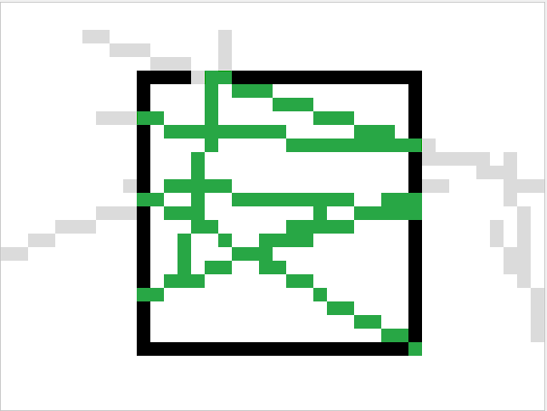

1.

2. Квадрат xmin = 10, ymin = 5, xmax = 30, ymax = 25

3. Если точка внутри окна, то код 0000; 
              слева от окна - 0001
              справа - 0010
              снизу - 0100
              сверху - 1000

4.  полностью внутри окна (15, 15);(16, 16) - ACCEPT
    полностью слева (1, 2);(15, 16) - REJECT
    полностью сверху (15, 1);(16, 2) - REJECT
    пересекает одну границу (15, 1);(18, 20) - пересечение TOP; ACCEPT
    пересекает две противоположные границы (15, 1);(18, 30) - пересечение TOP, BOTTOM; ACCEPT
    проходит через угол (8, 3);(32, 27) - пересечение TOP, BOTTOM; ACCEPT
    вертикальный (15, 1);(15, 30) - пересечение TOP, BOTTOM; ACCEPT
    горизонтальный (0, 15);(40, 15) - пересечение LEFT, RIGHT; ACCEPT
    обе точки снаружи, но отрезок проходит через окно (0, 0);(40, 30) - пересечение TOP, LEFT, BOTTOM, RIGHT; ACCEPT

5. Из 10 случайных отрезков в среднем 1-2 принимаются и 2-3 откидываются без вычисления пересечений
