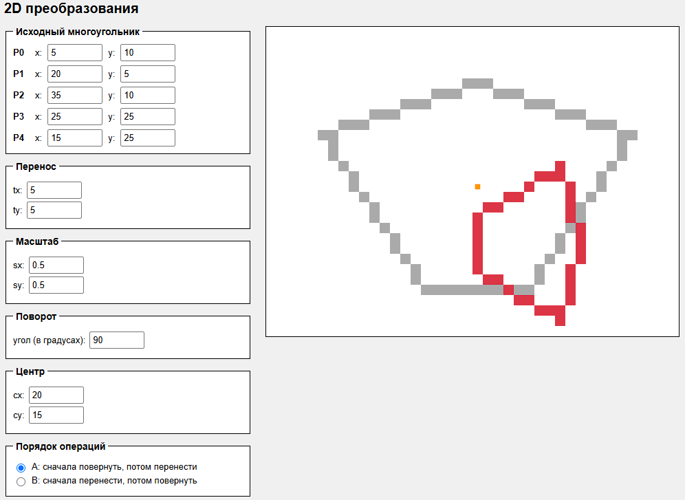

1. Запустить index.html

2. 
~~~text
T(tx,ty) = | 1  0  tx |
           | 0  1  ty |
           | 0  0   1 |
           
R(θ) = | cosθ  -sinθ  0 |
       | sinθ   cosθ  0 |
       |   0      0   1 |

S(sx,sy) = | sx  0  0 |
           |  0 sy  0 |
           |  0  0  1 |
~~~

3. C[i][j] = A[i][0]*B[0][j] + A[i][1]*B[1][j] + A[i][2]*B[2][j]

4. (20,15)

5.  Исходная точка (2,3); перенос tx=1, ty=3; поворот 90°; центр (0,0); перенос, потом поворот  
    (2,3) → (3,6) → (-6,3)

6.  Точка (5,10), центр (20,15), перенос tx=5, поворот на 90°  
    Поворот, перенос: (30,0)
    Перенос, поворот: (25,5)

7. Потому что умножение матриц некоммутативно

8. 
