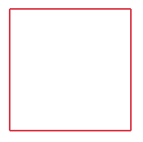
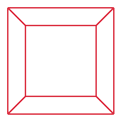

1. Ось x - вправо, y - вверх, z - от наблюдателя. Камера в начале координат, смотрит по направлению z

2. вершины куба = [  
    { x: -1, y: -1, z: -1 },  
    { x:  1, y: -1, z: -1 },  
    { x:  1, y:  1, z: -1 },  
    { x: -1, y:  1, z: -1 },  
    { x: -1, y: -1, z:  1 },  
    { x:  1, y: -1, z:  1 },  
    { x:  1, y:  1, z:  1 },  
    { x: -1, y:  1, z:  1 } ];  
ребра куба = [  
    [0,1], [1,2], [2,3], [3,0],  
    [4,5], [5,6], [6,7], [7,4],  
    [0,4], [1,5], [2,6], [3,7] ];  

вершины пирамиды = [  
    { x: -1, y: -1, z: -1 },  
    { x:  1, y: -1, z: -1 },  
    { x:  1, y: -1, z:  1 },  
    { x: -1, y: -1, z:  1 },  
    { x:  0, y:  1, z: 0 } ];  
ребра пирамиды = [  
    [0,1], [1,2], [2,3], [3,0],  
    [0,4], [1,4], [2,4], [3,4] ];  

3. Матрицы поворота
~~~text
Rx = | 1  0  0 0 |   Ry = |  c 0  s 0 |   Rz = | c -s 0 0 |
     | 0  c -s 0 |        |  0 1  0 0 |        | s  c 0 0 |
     | 0  s  c 0 |        | -s 0  c 0 |        | 0  0 1 0 |
     | 0  0  0 1 |        |  0 0  0 1 |        | 0  0 0 1 |
~~~

4. Правая матирца применяется первой, т.е. P_world = T * Rz * Ry * Rx * S * P_local: масштабирование - поворот по x - по y - по z - перенос

5. Ортографическая проекция:  
    screenX = centerX + scale * x  
    screenY = centerY - scale * y  

Перспективная проекция:  
    screenX = centerX + f * x / z  
    screenY = centerY - f * y / z,   где f - фокусное расстояние в пикселях, z > 0

6. Точка P = (1, 1, 1),  s=2, поворот на 90 градусов против часовой вокруг y, tz = 5, f = 300. Окно Canvas 600×500, scale для экранных координат ортографической проекции = 50  
    масштабирование: P = (2, 2, 2)  
    поворот: P = (2, 2, -2)  
    перенос tz: P = (2, 2, 3)  
    перспективная проекция: (500, 50)  
    ортографическая проекция: (400, 150)  

7. Плоскость отсечения z = near. Если у обеих точек z < near - ребро не рисуется; z >= near - ребро рисуется целиком; если одна за плоскостью - рисуется от точки пересечения с плоскостью до видимого конца

8. 
