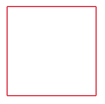
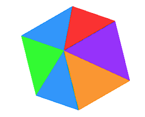
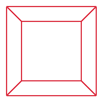
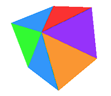

1. Добавлены:
  - рисование граней через треугольники
  - растеризация треугольника rasterTriangle
  - z-буфер для хранения глубины пикселя
  - отсечение невидимой части грани

2. a, b, c - вершины треугольника; p - точка (центр пикселя)  
   edge(a, b, p) = (b.x - a.x) * (p.y - a.y) - (b.y - a.y) * (p.x - a.x)  
   wa = edge(b, c, p) / area  
   wb = edge(c, a, p) / area  
   wc = edge(a, b, p) / area  
   где area = edge(a, b, c)  

3. цветовой буфер: массив pixels = image.data, куда записываются значения RGB и прозрачность для каждого пикселя. Готовый кадр отображается через ctx.putImageData(image, 0, 0);  

Z-буфер: массив depth, куда записывается значение глубины для каждого пикселя. Если значение глубины нового пикселя меньше чем у текущего, глубина и цвет перезаписываются

4. Потому что в перспективной проекции экранные координаты зависят от 1/z

5. Экранные координаты вершин треугольника и глубина: a=(10, 10, 1), b=(20, 20, 2), c=(0, 20, 3). p=(10, 15)  
  "площадь" = 10*10 - 10*(-10) = 200 => не вырожден  

  wa = (-20*(-5) - 0*(-10)) / 200 = 1/2  
  wb = (10*(-5) - (-10)*10) / 200 = 1/4  
  wb = (10*5 - 10*0) / 200 = 1/4          => точка внутри треугольника  

  глубина (ортографическая): z = 0.5*1 + 0.25*2 + 0.25*3 = 1.75  
  глубина (перспективная): invz = 0.5/1 + 0.25/2 + 0.25/3 ~ 0.7  
                              z = 1/0.7 ~ 1.4

6. при перекрывании граней, ближняя рисуется вне зависимости от порядка рисования

7. 

8. на обязательных ткстах программа работает корректно