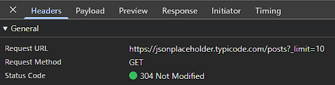
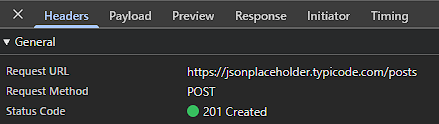
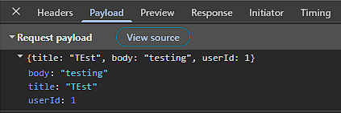
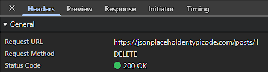
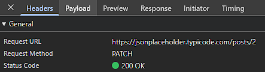
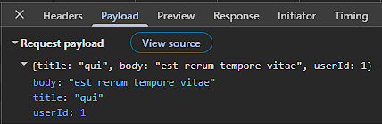

1. запустить index.html

2. https://jsonplaceholder.typicode.com/posts

3. GET, POST, PATCH, DELETE

4.const state = {
    posts: [],
    isLoading: false,
    isSaving: false,
    error: null,
    filter: '',
    editingId: null
  };

5. CRUD-функции выполняются через try-catch. Поля формы проверяются на пустоту

6. POST: 
    - отправляется POST-запрос
    - после ответа сервера новая публикация добавляется в начало массива
    - очищаются поля ввода
    - рендер состояния

   PATCH: 
    - отправляется PATCH-запрос
    - после ответа сервера изменяется одна конкретная публикация
    - сбрасывается режим редактирования
    - рендер состояния

   DELETE: 
    - отправляется DELETE-запрос
    - после ответа сервера удаляется публикация
    - рендер состояния

7. Потому, что JSONPlaceholder — учебный сервис. Он принимает POST, PATCH и DELETE и возвращает правдоподобные ответы, но реально не сохраняет изменения в базе.

