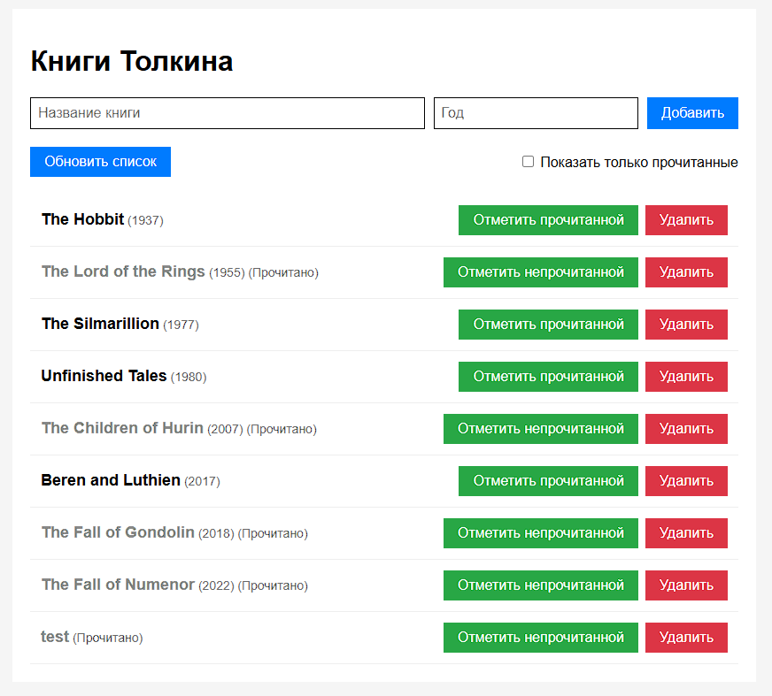
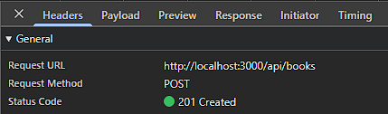
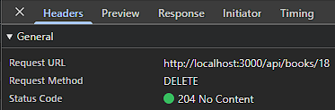

1. npm install, node server.js

2.  - `server.js` - Express-сервер + API + раздача статики из `public/`  
    - `public/index.html` - интерфейс  
    - `public/style.css` - внешний вид  
    - `public/app.js` - логика фронтенда  
    - `data.db` - база данных

3. Браузер (app.js) → fetch() → Express server.js → data.db → обновление массива `books` → `render()` → DOM

4.  - `GET /api/books` - список книг
    - `POST /api/books` - добавление книг
    - `PATCH /api/books/:id` - изменение статуса read
    - `DELETE /api/books/:id` - удаление

5.  Кнопка «Добавить» - добавление книги с введенным названием
    Кнопка «Обновить список» - перезапрашивает список  
    Кнопка «Отметить (не)прочитанной» - изменение статуса  
    Кнопка «Удалить» - удаление книги  
    «Только прочитанные» - фильтр только прочитанных

6. 
 

 

7. При попытке добавления книги без названия или удаления несуществующей книги через DevTools возникают ошибки 400 и 404

8. Данные сохраняются при перезапуске сервера

9. Чтобы текст интерпретировался как обычный текст, а не html код