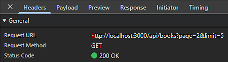
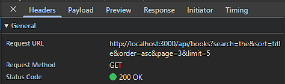
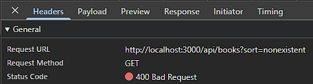
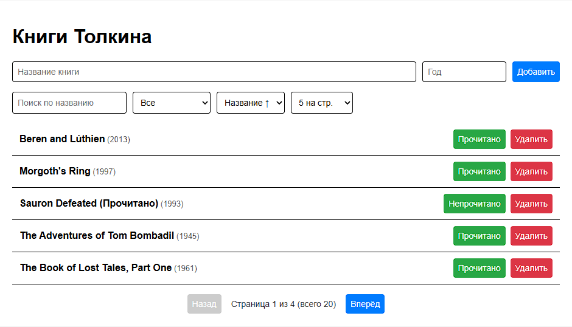

1.  Запустить node seed.js (для создания базы данных), node server.js; открыть http://localhost:3000

2. 
| Параметр | Допустимые значения |
|---|---|
| search | Строка до 50 символов |
| read | true, false, - |
| sort | id, title, year |
| order | asc, desc |
| page | положительное целое число |
| limit | 1-50 |

3. http://localhost:3000/api/books?sort=title&order=asc&page=1&limit=2
```json
{
  "items": [
    {
      "id": 20,
      "title": "Beren and Lúthien",
      "year": 2013,
      "read": false
    },
    {
      "id": 16,
      "title": "Morgoth's Ring",
      "year": 1997,
      "read": false
    }
  ],
  "pagination": {
    "page": 1,
    "limit": 2,
    "total": 20,
    "pages": 10
  }
}
```

4.  SELECT id, title, year, read FROM books  
    WHERE title LIKE ? AND read = ?  
    ORDER BY title ASC, id ASC  
    LIMIT ? OFFSET ?;  

5. Значения полей передаются через параметры и проверяются по белым спискам

6.  
 



7. Проверки:
    1) на первой странице 1-5 записи, на второй - 6-10
    2) total = числу подходящих фильтру записей, а не размеру страницы
    3) совместный поиск + фильтр работает корректно
    4) работает сортировка по году и названию
    5) при поиске книги с несуществующим названием выводится "Ничего не найдено"
    6) при ?sort=nonexistent возникает ошибка 400 (Bad Request) {"error":"Некорректные параметры запроса"}
    7) при удалении единственной записи с последней страницы переходит на новую последнюю страницу
    8) данные сохраняются после перезапуска сервера

8. При серверной фильтрации загружается только текущая страница; а не вся база данных, в которой потом происходит фильтрация