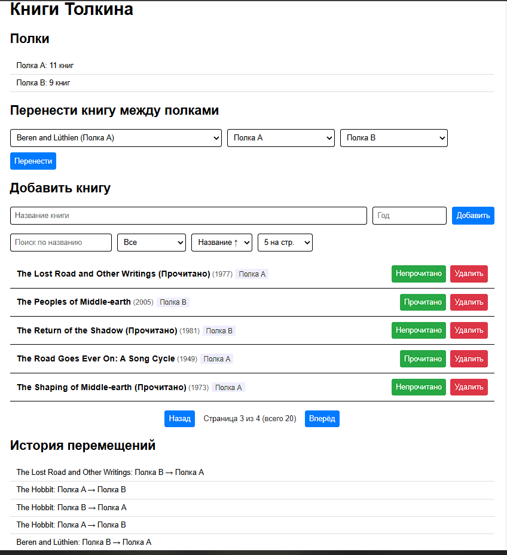
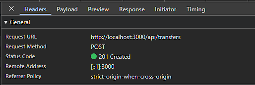
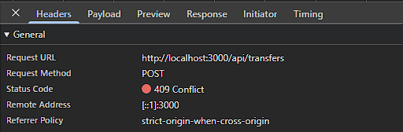
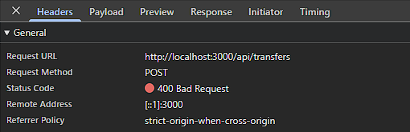

1. Пользователь может перенести книгу с одной полки на другую. Два запроса нужно, чтобы при переносе запись об этом обязательно сооздалась запись 

2.
~~~sql
CREATE TABLE IF NOT EXISTS shelves (
id INTEGER PRIMARY KEY AUTOINCREMENT,
name TEXT NOT NULL UNIQUE
)

CREATE TABLE IF NOT EXISTS books (
id INTEGER PRIMARY KEY AUTOINCREMENT,
title TEXT NOT NULL,
year INTEGER,
read INTEGER NOT NULL DEFAULT 0,
shelf_id INTEGER,
FOREIGN KEY (shelf_id) REFERENCES shelves(id)
)

CREATE TABLE IF NOT EXISTS transfers (
id INTEGER PRIMARY KEY AUTOINCREMENT,
book_id INTEGER NOT NULL,
from_shelf_id INTEGER NOT NULL,
to_shelf_id INTEGER NOT NULL,
FOREIGN KEY (book_id) REFERENCES books(id),
FOREIGN KEY (from_shelf_id) REFERENCES shelves(id),
FOREIGN KEY (to_shelf_id) REFERENCES shelves(id),
CHECK (from_shelf_id <> to_shelf_id)
)
~~~
- PRIMARY KEY - автоматически генерируется уникальный идентификатор
- NOT NULL- обязательные поля
- UNIQUE - Названия полок не повторяются
- FOREIGN KEY - книга ссылается на существующие полки, запись в истории ссылается на существующие книги и полки
- CHECK (from_shelf_id <> to_shelf_id) - проверка, что книга не переносится с полки на эту же полку

3. При переносе книги суммарное количество книг на полках не меняется

4. Транзакция transferTx. 
~~~javascript
const transferTx = db.transaction((bookId, fromShelfId, toShelfId) => {
  const update = db.prepare(
    'UPDATE books SET shelf_id = ? WHERE id = ? AND shelf_id = ?'
  ).run(toShelfId, bookId, fromShelfId);

  if (update.changes !== 1) {
    throw new Error('BOOK_NOT_ON_SOURCE_SHELF');
  }

  const log = db.prepare(
    'INSERT INTO transfers (book_id, from_shelf_id, to_shelf_id) VALUES (?, ?, ?)'
  ).run(bookId, fromShelfId, toShelfId);

  return { transferId: Number(log.lastInsertRowid), bookId, fromShelfId, toShelfId };
});
~~~
При любом исключении внутри callback изменения это транзакции откатываются

5. Запрос: curl -i -X POST http://localhost:3000/api/transfers -H "Content-Type: application/json" -d "{\"bookId\":1,\"fromShelfId\":1,\"toShelfId\":2}"  
Успешный ответ: {"transferId":2,"bookId":1,"fromShelfId":1,"toShelfId":2}  

Запрос: curl -i -X POST http://localhost:3000/api/transfers -H "Content-Type: application/json" -d "{\"bookId\":1,\"fromShelfId\":2,\"toShelfId\":1}"  
Ответ: {"error":"Книга не на полке-источнике"} (HTTP/1.1 409 Conflict)  

6. Данные после успешной операции: книга переместилась на другую полку, добавилась запись в журнал.  
Данные после искусственного сбоя: книга там же, записей не добавилось

7. После перезапуска сервера измененя в базе сохраняются

8. 

9. Валидация в браузере проверяет корректность в полях ввода, но ее можно обойти через Devtools. Серевер проверяет, что от браузера пришли корректные данные. Проверки SQLite может откатить изменения при ошибках в работе сервера.